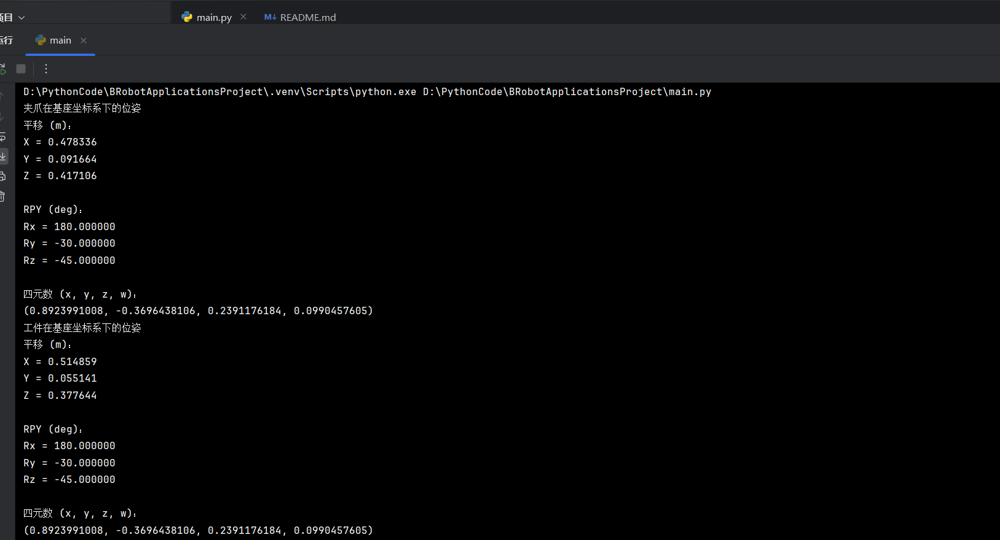
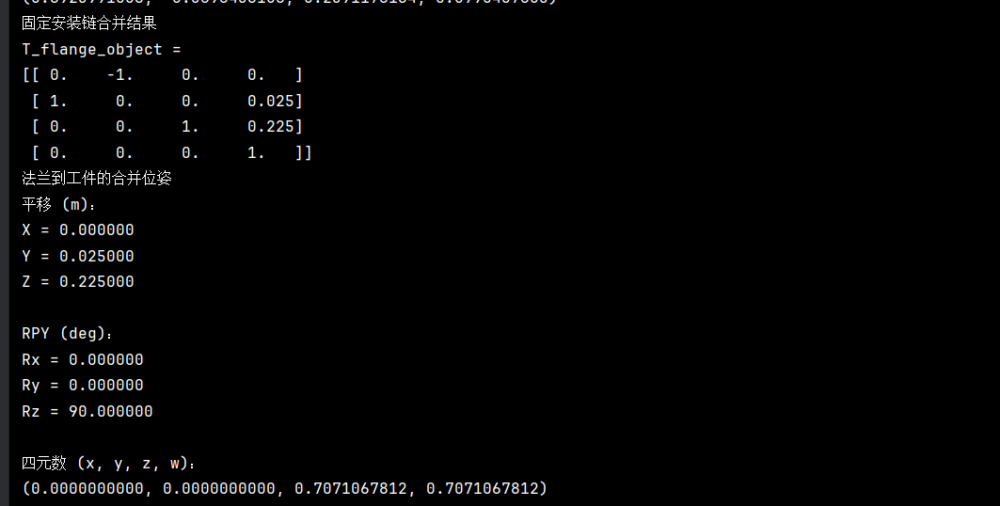
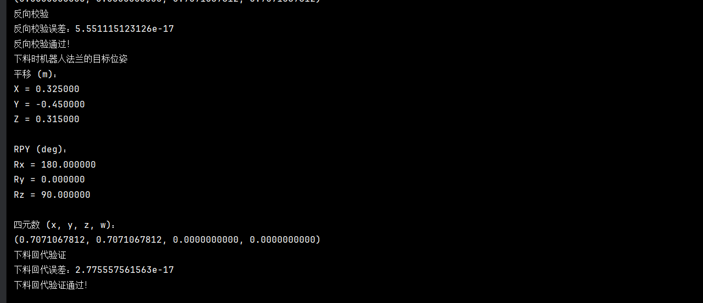

# 运行截图

# 固定安装链合并说明

由于夹爪与法兰之间的安装关系固定，并且工件被夹紧后与夹爪之间不存在相对运动，因此： T_Flange^Object= T_Flange^Gripper×T_Gripper^Object是一个固定不变的齐次变换矩阵。
在实际机器人应用中，可以提前计算该矩阵并缓存起来，避免每次计算工件位姿时都重复执行两次矩阵乘法
合并后：

正向计算：直接通过法兰位姿与合并后的固定变换，计算工件位姿
反向计算：通过工件目标位姿与合并变换的逆矩阵，直接求出法兰目标位姿

这样可以减少重复计算，提高代码效率，让机器人运行更快

# 验证

将计算出的工件位姿反解回法兰位姿，与题目给定的法兰位姿比较，最大绝对误差小于 10^（-9）
将下料计算得到的法兰目标位姿重新进行正向计算，验证工件是否到达给定的目标位姿，最大绝对误差小于10^（-9）

