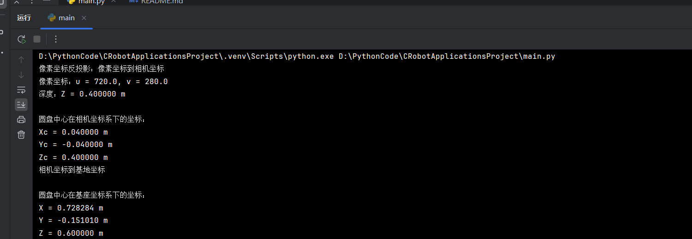
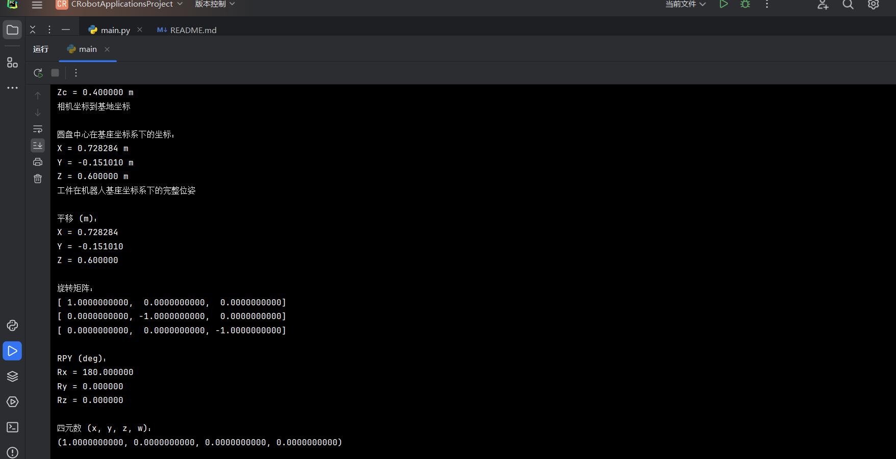

# 运行

# 说明

这个题就是 相机固定安装在机器人工作台上方，通过相机内参计算圆盘工件在相机坐标系下的位置，再利用手眼标定结果转换到机器人基底坐标系，最终计算机器人法兰的抓取目标位姿

# 已知

相机内参: fx = 800  fy = 800 cx = 640 cy = 360

手眼标定结果: 相机在机器人基座坐标系下的位姿：
平移：(0.700, -0.200, 1.000) m
RPY：(180°, 0°, 15°)

视觉检测结果:
像素坐标：(720, 280)
深度：0.400 m

夹爪安装关系:
夹爪相对法兰平移：(0.000, 0.000, 0.165) m
RPY：(0°, 0°, 45°)

# 像素到相机

根据题一的公式：

xc = (u - cx) * Zc / fx

yc = (v - cy) * Zc / fy

zc = Zc

则

P_camera = (0.040, -0.040, 0.400) m

# 相机到基座

利用相机在基座坐标系下的固定变换矩阵：

T_base_camera

再通过题目给的齐次变换：

P_base = T_base_camera * P_camera

得到圆盘中心在基座坐标系下的位置：

P_base = (0.728284, -0.151010, 0.600000) m

# 工件完整位姿

圆盘平放在水平台面上，法向竖直。

由题目得, RPY = (180°, 0°, 0°)

工件完整位姿：
平移：(0.728284, -0.151010, 0.600000) m
姿态：(180°, 0°, 0°)

答:圆盘本身对称 因此不需要识别类似长条工件的长轴方向 其绕基座 Z 轴的朝向可以任意选择

